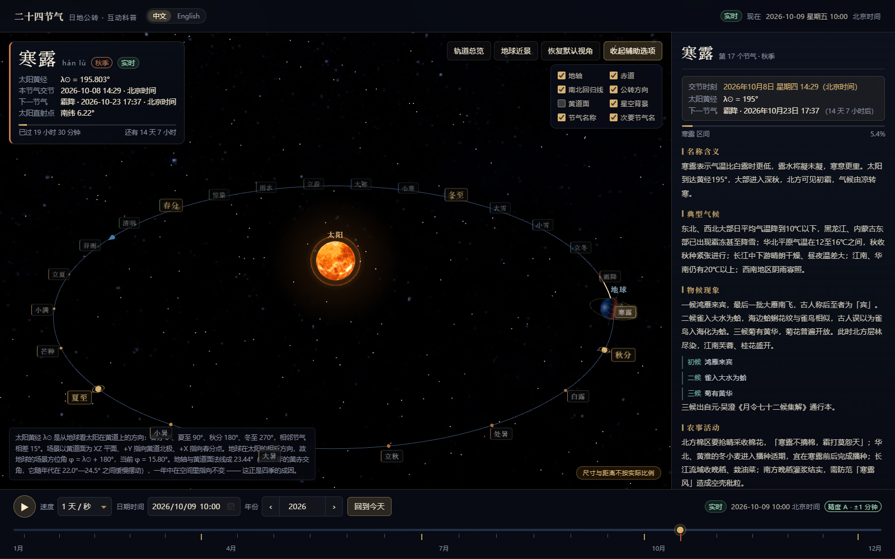
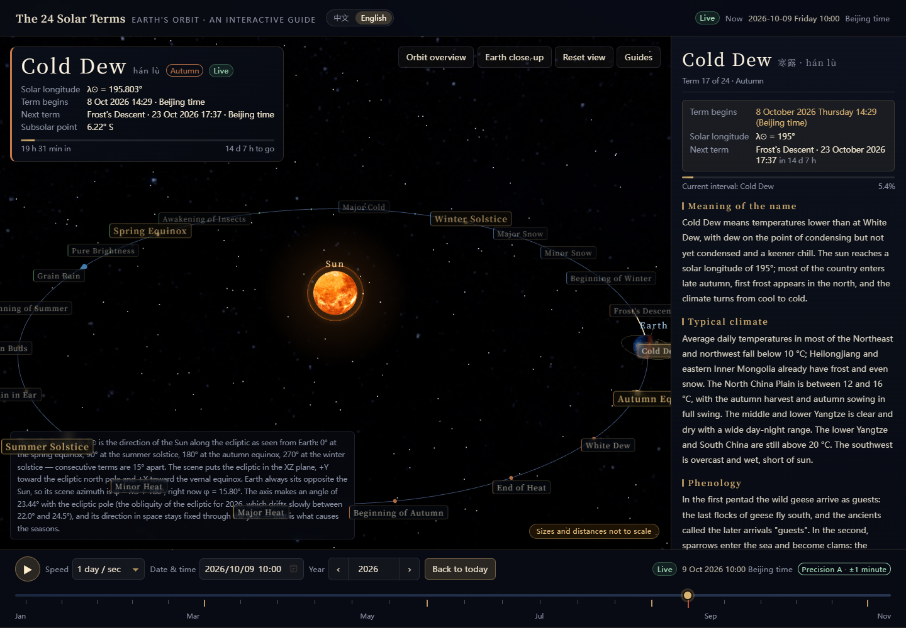
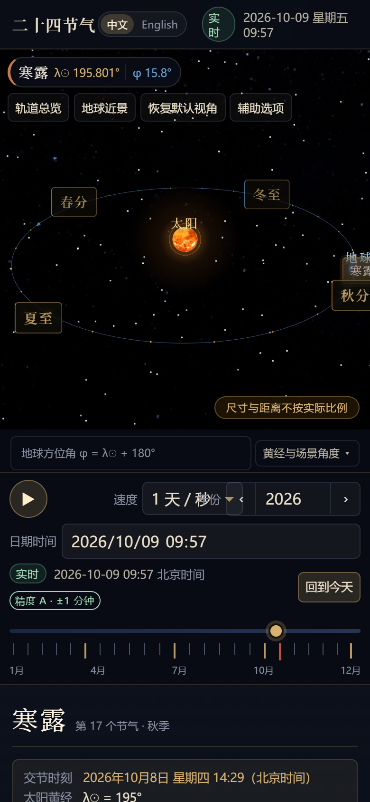

# 二十四节气 · 日地公转互动科普

**The 24 Solar Terms — an interactive guide to the Sun–Earth orbit**

[](#天文与内容自检)
[](#浏览器端验收)
[](#移动端专项验收)
[](LICENSE)

一个用 **Three.js** 呈现地球绕日公转的 3D 场景，直观展示**节气、太阳黄经与季节变化**之间的关系，
并介绍二十四节气的历史渊源、文化价值与节气歌的互动科普网站。**支持中文与英文**，可在顶栏一键切换。

面向普通大众，兼顾天文科普的真实感与中国传统文化的美感。节气时刻不是查表得来的，
而是由 VSOP87 级数反解太阳地心视黄经算出来的。

> **In English:** an interactive 3D scene of Earth's orbit that shows how the 24 solar terms
> relate to solar longitude and the seasons, together with the history, cultural value and
> the traditional mnemonic song. Every term instant is *solved* from the Sun's apparent
> geocentric ecliptic longitude (truncated VSOP87 + nutation + aberration, ΔT applied),
> not looked up from a table. Fully bilingual (Chinese / English), works from 2000 BCE to 6000 CE,
> and reports its own precision honestly as it moves away from the present.



<table>
<tr>
<td width="50%"></td>
<td width="50%"></td>
</tr>
<tr>
<td align="center">英文版</td>
<td align="center">移动端</td>
</tr>
</table>

---

## 快速开始

```bash
# 1. 安装依赖（项目已内置 .npmrc，使用国内镜像与本地缓存目录）
pnpm install

# 2. 启动开发服务器（默认 http://127.0.0.1:5183）
pnpm dev

# 3. 生产构建与本地预览
pnpm build
pnpm preview
```

> 如果 `public/textures/` 下的纹理缺失，页面仍可正常运行：会自动改用程序化生成的替代纹理并给出提示。
> 需要重新下载纹理时执行 `node scripts/fetch-textures.mjs --force`。

### 常用脚本

| 命令 | 作用 |
| --- | --- |
| `pnpm dev` | 启动 Vite 开发服务器（默认 http://127.0.0.1:5183） |
| `pnpm build` | 生产构建，输出到 `dist/` |
| `pnpm preview` | 预览构建结果 |
| `pnpm preview:dist` | 不依赖 vite/esbuild 的极简静态预览（默认 http://127.0.0.1:4180） |
| `pnpm typecheck` | `vue-tsc` 全量类型检查 |
| `pnpm textures` | 补齐缺失的行星纹理（`--force` 可强制重下） |
| `pnpm verify:astro` | **天文计算 + 内容数据自检（152 项断言，含中英双语一致性）** |
| `pnpm verify:browser` | **浏览器端验收（105 项断言 + 自动截图，含语言切换）** |
| `pnpm verify:mobile` | **移动端专项验收（26 项断言 + 7 张设备截图）** |
| `pnpm export:terms` | **导出任意年份区间的节气数据（CSV / JSON / Markdown）** |
| `pnpm report:longterm` | 长期演化报告：各年代的 ΔT、回归年长度、季节长度、黄赤交角 |

### 天文与内容自检

```bash
pnpm verify:astro
```

覆盖 152 项断言：

- 节气表的顺序、名称、黄经与季节；24 节气在 1900/1950/2000/2024/2025/2050/2100 各年齐备且按时间升序；
- 交节时刻处太阳黄经的反解残差 < 1e−4 度；
- 相邻节气间隔落在 14.6—15.8 日之间**且确实不均匀**；近日点附近间隔短于远日点附近（开普勒第二定律）；
- 与日本国立天文台（NAO）《暦要項》公布的 2024、2025 年交节时刻逐条比对（含秒级偏差诊断）；
- 交节时刻前后 1 毫秒的区间判定、跨年衔接、区间进度；
- 地轴与日地连线的夹角在春分/秋分为 0、夏至为 +sin ε、冬至为 −sin ε；地轴倾角 23.44°；场景方位角 φ = λ☉ + 180° 全周一致；
- 分至点的太阳视赤纬与太阳直射点纬度；
- 节气歌按位置映射到 0—23 且不重不漏；
- 24 条节气详情与基础表逐条一致、字段非空、三候齐全、诗词有作者与出处、气候物候点明地域差异；
- 历史时间线、文化价值、科普问答、参考来源的完整性与四条必答问题。

### 浏览器端验收

```bash
# 先启动任意静态服务器（二选一）
pnpm dev              # 或 pnpm preview:dist
pnpm verify:browser   # 默认访问 http://127.0.0.1:4180/
```

脚本通过 Chrome DevTools Protocol 驱动本机 Edge 的无头模式，用**真实鼠标事件**验证交互（105 项断言），
并把截图写入 `shots/`：

- 3D 场景真的渲染出画布、WebGL 上下文可用、轨道上有 24 个节气标签、四个分至点被突出；
- 读出卡显示节气名、太阳黄经、交节时刻与下一节气，并标出「尺寸与距离不按实际比例」；
- 点击节气歌的字 → 暂停播放、切为模拟时间、3D 与详情面板同步到该节气；
- 点击节气一览的「夏至」→ 详情切换、黄经为 90°、该项被标为当前；
- 用鼠标**拖动年度时间轴** → 时间轴位置、日期文本、节气名与 3D 方位角读数同步更新；
- 黄经读数与节气名自洽（按黄经反查应得的节气名一致）；
- 回到今天 / 播放 / 暂停 / 调速 / 三个视角按钮 / 8 个辅助线开关；
- 年份可前后切换，且 1900 与 2100 两端按钮正确禁用、1900 年仍能算出 24 个节气时刻；
- 节气歌 4 句 28 字（24 个节气字 + 4 个衬字）、历史 ≥ 10 条、文化 6 个方面、科普 ≥ 4 条、来源 ≥ 8 条、详情含三候诗词农谚；
- 选择日期与时刻后，交节边界精确正确（2025-03-20 17:00 判为惊蛰、17:02 判为春分）；
- 所有可聚焦控件都有无障碍名称。

> 若本机 Edge 不在默认路径，可设 `EDGE_PATH` 环境变量；若预览地址不同，可设 `PREVIEW_URL`。
>
> 两点说明：
> · 脚本按进程树结束自己启动的无头浏览器（`taskkill /T`），不会碰到你正在用的 Edge。
> · **截图是尽力而为的产物，失败只会打印一条 ⚠️，不影响验收结论** ——
>   软件渲染（SwiftShader）连续抓很多张图后会内存吃紧。断言才是判定依据。

### 移动端专项验收

```bash
pnpm preview:dist      # 或 pnpm dev
pnpm verify:mobile
```

用 CDP 的**移动设备模拟 + 真实触摸事件**，覆盖 6 种设备尺寸
（360×640 小屏安卓、375×667、390×844、430×932、844×390 横屏、768×1024 平板竖屏），
逐项排查移动端最常见的坑：

- **横向溢出**：任何会把文档撑宽的元素（被 `overflow:hidden` 裁掉的不算），
  以及「布局视口是否等于设备宽度」——后者一旦被撑大，整页会被缩小，点按坐标全部带偏；
- **纵向翻页**：手指在 3D 画布上滑动能否翻页（`touch-action` 是否把页面滚动吃掉），
  横向滑动是否只旋转视角而不误触发翻页，双指捏合是否只缩放 3D 而不把页面缩放坏；
- **触屏点按**：哪些节气标签真正点得中（`elementFromPoint` 命中自身）、
  标签与时间轴刻度的命中高度是否 ≥ 24px、播放按钮是否 ≥ 40×40；
- **排布**：3D 区高度、时间控制条是否排在详情区之前、窄屏高度是否可接受；
- **兼容**：`dvh`、刘海屏安全区 `env()`、表单字号 ≥ 16px（避免 iOS 聚焦自动放大）、
  `select`/`datetime-local` 的 `appearance` 与深色底色对比；
- 自动输出 `shots/mobile-*.png` 供人工核对。

---

## 目录结构

```
src/
├─ astro/                  纯天文计算（不含任何渲染代码，可独立测试）
│  ├─ vsop87.ts            VSOP87D 地球日心黄道坐标截断级数（Meeus 附录 III）
│  ├─ sun.ts               太阳地心视黄经 / 赤经赤纬 / 章动 / 光行差 / 恒星时 / 均时差
│  ├─ deltaT.ts            ΔT = TT − UT1：实测锚点插值 + 分段多项式 + 平滑过渡
│  ├─ deltaTTable.ts       1973—2025 年实测 ΔT 年度锚点表（由开发期数据生成）
│  ├─ julian.ts            儒略日 ↔ 公历（不依赖 JS Date，无年份上限）
│  ├─ solarTerms.ts        反解交节时刻、年度节气表、节气区间判定、精度分级
│  ├─ bodyPosition.ts      把天文量整理成场景需要的状态
│  ├─ sceneFrame.ts        天文坐标 ↔ Three.js 场景坐标的映射约定
│  └─ time.ts              北京时间（UTC+8）工具
├─ data/                   内容数据
│  ├─ terms.ts             24 节气基础表（顺序 / 名称 / 黄经 / 季节）
│  ├─ termDetails.ts       24 节气详情（含义、气候、物候三候、农事、习俗、饮食、诗词、农谚）
│  ├─ history.ts           历史渊源时间线
│  ├─ culture.ts           文化价值（6 个方面 / 22 个具体例子）
│  ├─ science.ts           科普问答
│  ├─ song.ts              节气歌逐字映射
│  ├─ sources.ts           参考来源与数据精度说明
│  ├─ en/                  以上各项的英文版（termDetails / history / culture / science / sources / song）
│  └─ index.ts             按语言归一成统一视图模型 + 中英一致性检查
├─ three/                  3D 渲染
│  ├─ SceneManager.ts      渲染器 / 相机 / 光照 / 每帧调度 / 视角预设 / 生命周期
│  ├─ earth.ts             地球：海陆纹理、云层、大气辉光、昼夜明暗、地轴赤道回归线
│  ├─ sun.ts               太阳：表面纹理、日冕、光晕、主光源
│  ├─ orbit.ts             轨道线、24 个节气标记、当前区间高亮
│  ├─ textures.ts          纹理加载与程序化回退
│  └─ config.ts            场景常量、配色、画质档位
├─ i18n/                   轻量国际化
│  ├─ messages.ts          界面文案字典（中文为真源，英文漏翻会编译报错）
│  └─ index.ts             语言状态、t()、持久化与 URL 同步
├─ composables/
│  ├─ useSimulation.ts     全局唯一的模拟时间状态
│  └─ useContent.ts        按语言取内容数据
└─ components/             界面组件（含 LanguageSwitch.vue）

scripts/
├─ fetch-textures.mjs      开发期下载行星纹理（不进运行时）
├─ preview-dist.mjs        极简静态服务器，预览 dist/
├─ verify-astro.cjs        天文 + 内容数据自检（97 项）
├─ verify-browser.mjs      CDP 浏览器验收 + 自动截图（105 项）
├─ verify-mobile.mjs       CDP 移动端专项验收 + 多设备截图（26 项）
├─ export-terms.cjs        节气数据导出（不依赖浏览器，数据「逃生舱」）
├─ longterm-report.cjs     长期演化报告（ΔT / 回归年 / 季节长度 / 黄赤交角）
├─ reference-solar-terms.json   2024/2025 年节气时刻参照表（NAO）
└─ reference-delta-t.json       1973—2025 年 ΔT 实测锚点（IERS/USNO 等）
```

---

## 关键实现说明

### 1. 节气时刻是**算出来的**，不是查表得来的

页面没有使用任何「固定日期表」。给定年份后，程序对每个节气反解方程

```
λ☉(t) = 目标黄经        （春分 0°、夏至 90°、秋分 180°、冬至 270°，相邻相差 15°）
```

其中太阳地心视黄经 λ☉ 由以下步骤算出：

1. **VSOP87D 截断级数**求地球日心黄道坐标 `(L, B, R)`（Meeus《Astronomical Algorithms》附录 III）；
   注意三组级数统一以 `1e−8` 为单位（L、B 为 1e−8 弧度，R 为 1e−8 AU），三者都要除以 1e8。
2. 换算为太阳地心黄经 `Θ = L + 180°`、黄纬 `β = −B`。
3. 归算到 FK5 系统（`ΔΘ = −0.09033″`）。
4. 加**黄经章动 Δψ**（Meeus 22.2 式）与**周年光行差** `−20.4898″/R`。

反解用牛顿迭代，斜率取太阳黄经平均变化率 0.98564736°/日。真实角速度在 ±3.4% 之间变化
（近日点快、远日点慢），迭代以约 0.03 的比率收敛，初值即使偏差 5 天，6 次迭代后残差也可忽略。

最后把力学时（TT）换算为世界时：`UT = TT − ΔT`，再转为北京时间（UTC+8）。
自检显示，交节时刻处的黄经残差小于 `1e−4` 度。

### 2. 定气法：节气间隔本来就不相等

自 1645 年清《时宪历》起，中国由「平气法」（把一回归年平分成 24 份）改为**定气法**
（以太阳黄经每 15° 为一个节气）。由于地球公转轨道是椭圆，
近日点附近（1 月初）角速度快，小寒→大寒等间隔只有约 **14.7 天**；
远日点附近（7 月初）角速度慢，小暑→大暑等间隔可达约 **15.7 天**。

这一点在页面上有两处直观体现：年度时间轴的刻度按真实交节时刻摆放，肉眼可见疏密不均；
自检脚本也会断言「近日点附近的间隔短于远日点附近」。

### 3. 地轴方向在一年中保持不变 —— 四季的真正成因

场景坐标约定（详见 `src/astro/sceneFrame.ts`）：

- `XZ` 平面 = 黄道面，`+Y` = 黄道北极，`+X` = 春分点方向（黄经 0°）；
- 黄经增大对应从 `+Y` 俯视的**逆时针**方向，即 `x = r·cosβ·cosλ`，`y = r·sinβ`，`z = −r·cosβ·sinλ`。

容易搞错的地方是**太阳黄经与地球位置的关系**：太阳视黄经是从**地球**看太阳的方向，
而地球永远在太阳的相反方向，所以

```
地球日心黄经 L⊕ = λ☉ + 180°      地球场景方位角 φ = λ☉ + 180°
```

例：春分 λ☉ = 0° 时地球位于场景 `(−r, 0, 0)`，太阳在 `+X` 方向；夏至 λ☉ = 90° 时地球位于
`(0, 0, +r)`，太阳方向为 `(0, 0, −1)`，此地轴恰好朝 `(0, 0, −1)` 一侧倾斜，北半球倾向太阳。

地轴方向是一个**常量**：`(0, cos 23.4393°, −sin 23.4393°)`。
它只在 `tiltGroup` 上设置一次旋转，**与地球在轨道上的位置无关**，因此绝不会出现
「地轴始终朝向太阳」这个常见错误。自检脚本会断言：春分与秋分时地轴与日地连线垂直（cos = 0），
夏至时为 `+sin ε`，冬至时为 `−sin ε`。

### 4. 统一时间驱动一切

全站只有一个时间源 `src/composables/useSimulation.ts` 中的 `simMs`。
`SceneManager` 每帧回调 `onFrame(dt)`：**先把模拟时间往前推，再用同一个时刻**算出
地球位置、太阳黄经、当前节气区间、轨道高亮区间，返回给场景作画。
界面上的读出卡、详情面板、时间轴、节气一览也都派生自同一个 `simMs`，
因此不会出现「地球位置和文字对不上」的情况。

派生量做了粒度拆分（`activeTerm` 返回的是缓存对象，引用稳定），
避免每帧触发整棵组件树重渲染。

### 5. 地球渲染

- 地球表面用 `MeshPhongMaterial`（昼面贴图 + 法线贴图 + 海洋高光贴图），
  通过 `onBeforeCompile` 注入两段逻辑：夜面按 `dot(法线, 太阳方向)` 叠加城市灯光贴图；
  晨昏线附近叠加一层暖色散射薄边。
- 云层是略大一圈的独立球体，以同一张贴图同时作 `map` 与 `alphaMap`。
- 大气是半径 1.06 倍的 `BackSide` 球壳，用菲涅耳式边缘辉光并乘以日照因子，
  夜侧保留微弱辉光。
- 地球自转相位由**格林尼治真恒星时 GAST** 驱动，所以「哪个经度正对太阳」也是真实的。
- 光源是位于原点的 `PointLight`，地球在轨道任意位置都自动得到正确的受光方向 ——
  这是几何本身保证的，不是手工调整的。

### 6. 轨道保留真实的近圆特征

轨道线由真实星历采样一个回归年得到，而不是画一个圆或夸张的椭圆。
地球轨道偏心率约 **0.0167**（近日点 0.983 AU、远日点 1.017 AU），
所以真实轨道在视觉上几乎就是正圆 —— 若为了「好看」把它画扁，反而是失真的。
24 个节气标记落在「该节气交节瞬间地球所在的位置」上，方位角与太阳黄经严格对应。

### 7. 性能与降级

- `config.detectQuality()` 依据 UA、CPU 核心数、屏幕尺寸与 `prefers-reduced-motion`
  选择 `high` / `medium` / `low` 三档，调节球体分段数、星空点数、像素比上限与抗锯齿。
- `low` 档自动隐藏次要节气名称，移动端默认关闭抗锯齿。
- `document.hidden` 时**完全停掉 `requestAnimationFrame`**，页面恢复可见时继续。
- 组件卸载 / 场景销毁时释放几何体、材质、纹理、控制器与渲染器，并移除 DOM。
- 监听 `webglcontextlost`，丢失上下文时给出可刷新的提示层而不是白屏。

### 8. 可访问性

- 轨道上的每个节气都是一个真正的 `<button>`（带 `aria-label`），可点击、可聚焦、触屏命中面积大；
  3D 画布本身标了 `role="img"` 与动态 `aria-label`，并有一段 `sr-only` 的操作说明。
- 时间轴、播放/暂停、速度、日期、年份等控件都有可见标签与键盘支持。
- 空间上的旋转 / 缩放由 OrbitControls 提供，同时支持鼠标、滚轮、单指拖动与双指捏合。

### 9. 移动端适配要点

移动端踩过的坑与对应处理（都由 `pnpm verify:mobile` 断言覆盖）：

| 问题 | 处理 |
| --- | --- |
| 手指落在 3D 画布上页面完全划不动 | OrbitControls 会把画布 `touch-action` 写成 `none`。触屏设备上覆写为 `pan-y`：**上下滑动翻页、左右滑动旋转视角、双指捏合缩放** |
| 单个长网址把文档撑宽，移动端浏览器因此缩小布局视口，连带把 3D 场景与点按坐标全带偏 | 参考来源的链接加 `overflow-wrap: anywhere`；时间轴刻度容器 `overflow: hidden` |
| 时间控制条被挤到详情区之后，要翻很久才能改时间 | 用 grid 显式摆放：移动端顺序为 **3D → 时间控制 → 详情**（桌面端仍是左 3D / 右详情 / 底部时间条） |
| 时间控制条在窄屏换行成 5 行、吃掉半个屏幕 | 窄屏改用显式 grid 排成三行；日期与时间合并为一个 `datetime-local`；宽度受限的控件单独占一行 |
| 手机上控件太密、手指点不中 | 时间轴刻度命中高度提到 26—30px；轨道节气标签在触屏上加大内边距至 ≥ 24px；缩小标签的缩放幅度 |
| 小屏上 24 个节气标签挤成一团、互相压住 | 小屏默认只显示四个分至点 + 当前节气（共 5 个，互不重叠、全部点得中），可在「辅助选项」里打开全部 |
| iOS Safari 聚焦字号 < 16px 的输入框会自动放大页面 | 触屏设备上表单控件字号统一 16px |
| iOS 上 `select` / 日期控件沿用系统浅色皮肤，深色主题下白底浅字看不清 | `appearance: none` + 自绘下拉箭头 + 反色日历图标 |
| 刘海屏 / 圆角屏遮挡 | 顶栏、时间条、页脚都加 `env(safe-area-inset-*)` 留白 |
| 横屏手机屏幕很矮 | 专门的 `@media (max-height: 520px) and (orientation: landscape)`：压低 3D 区、收起角度说明 |
| 地址栏收放导致视口高度跳变 | 用 `dvh`（并保留 `vh` 回退），配合 ResizeObserver 同步渲染尺寸 |

「太阳黄经 ↔ 场景方位角」的对应关系在移动端也不会丢失：
读出胶囊上始终并列显示 `λ☉` 与 `φ`，下方还有一行 `φ = λ☉ + 180°` 与可展开的完整说明。

### 10. 数据来源与精度

| 项目 | 说明 |
| --- | --- |
| 太阳位置 | VSOP87D 截断级数（Meeus 附录 III，三组级数统一以 1e−8 为单位）+ FK5 归算 + 黄经章动 + 周年光行差 |
| ΔT | 1973—2025 年：IERS / USNO **实测年度锚点值**线性插值（多来源交叉核对差异 ≤ 0.05 秒）；其余年份：Espenak & Meeus 分段多项式（NASA/TP-2006-214141），并在区间两端做平滑过渡 |
| 为什么需要过渡 | E&M 多项式对 2025 年给出约 74.5 秒，实测只有约 69.2 秒，相差约 5 秒；直接切换会让 ΔT 在一年内跳变 5 秒，平滑摊到十年后折合每年约 0.5 秒，与历史变化幅度相当 |
| 时区 | 固定 UTC+8（北京时间）。中国自 1991 年夏令时结束后全年 UTC+8，官方天文年历亦使用东经 120° 标准时 |
| 支持年份 | **1900—2100 年**（界面上的年份选择只在真实支持的范围内开放） |
| 精度 | 与日本国立天文台（NAO）《暦要項》公布的 2024、2025 年交节时刻逐条比对，**最大偏差 1 分钟**；秒级诊断显示平均偏差 +3.3 秒 / −1.3 秒（公布值本身只精确到分钟，理论上限即 30 秒）。2026 年以后因 ΔT 只能外推，误差可能增大到约 ±1~2 分钟 |
| 页面精度声明 | **±1 分钟** |

页面明确区分两个概念：**节气区间**（当前已经进入哪个节气，从它的交节时刻算起）
与**交节时刻**（该节气开始的那一个确切瞬间）。

### 11. 「不受年份限制」是怎么做到的

页面原先只开放 1900—2100 年。要把它变成「赛博永生」，得先分清**四层完全不同的限制**——
前三层是软件问题，可以解决；第四层是物理问题，只能如实标注。

| 层 | 原来的瓶颈 | 现在的做法 |
| --- | --- | --- |
| **历法层** | `Date.UTC(y,…)` 在 0 ≤ y ≤ 99 时会把年份当成 19xx（`Date.UTC(50,0,1)` → 1950 年），且可表示范围止于 ±27 万年 | 改用 `src/astro/julian.ts` 的**儒略日算法**（Meeus 第 7 章），全程浮点运算，没有年份上限，公元前也能正确处理 |
| **输入层** | 年份控件的 `min`/`max` 写死，时间轴只覆盖单一年份 | 年份可输入 −2000 — +6000；`datetime-local` 只支持四位年份，超出时自动降级为文本框；年份框带跨越千年的候选下拉 |
| **场景层** | 黄赤交角写死 23.4393°，于是公元 5000 年的南北回归线还被画在 ±23.44° | 黄赤交角改为**按年代计算**（`obliquityDegAt`），地轴倾角与南北回归线随之更新：公元前 1000 年 ±23.82°、公元 5000 年 ±23.06° |
| **物理层** | ΔT（TT − UT1）在 2025 年之后没有观测值，只能外推 | 无法消除，改为**如实分级**：页面实时显示 A/B/C/D 四个精度档与对应误差量级 |

#### 物理上限在哪里

```bash
pnpm report:longterm      # 实测各年代的 ΔT、回归年长度、季节长度、黄赤交角
```

这个脚本用同一套天文核心算出不同年代的行为，几个关键结论：

- **ΔT 是民用时刻的最终天花板。** 公元 3000 年约 74 分钟，公元 5000 年约 9 小时，
  公元 8000 年约 34 小时 —— 超过一天之后，连「节气落在哪一天」都不再可靠。
  这**不是代码问题**：地球自转的不规则变化在原理上无法长期预测。
- **回归年长度在缓慢变化**，节气间隔也随之改变（模型能复现，见报告第 2 节）。
- **岁差会把近日点搬进夏天**：现在近日点在 1 月初，北半球夏半年比冬半年长约 7.6 天；
  到公元约 7000—8000 年两者持平，之后**翻转**，夏半年反而更短（报告第 3 节）。
  这是模型自然算出来的，不是写死的。
- 因此把上限定在 **+6000 年**：那一年 ΔT 约 5 小时，「时刻」还能标注，「日期」仍然正确。

#### 信息层面的永生

真正会让内容消失的往往不是天文，而是**技术栈**。为此做了两件事：

1. **天文核心零依赖。** `src/astro/` 里没有任何 DOM、Vue、Three.js 的引用，
   全是纯函数。它可以被整体搬到任何语言、任何运行环境，不需要浏览器。
2. **提供脱离网页的导出口。**

   ```bash
   pnpm export:terms -- --from 2000 --to 2030 --format csv  > terms.csv
   pnpm export:terms -- --from 1900 --to 2100 --format json > terms.json
   pnpm export:terms -- --from 4990 --to 5010 --format md
   ```

   导出的 CSV / JSON / Markdown **自带计算口径说明**（节气定义、算法步骤、ΔT 来源、
   时区、历法、精度等级与黄经残差），脱离本页也能被理解与复核。
   哪怕这个网站和它的框架都不复存在，任何人拿到仓库仍然可以重新生成全部数据。

#### 还想更远的话

- **换成高精度星历表。** 目前用的是 Meeus 简化版 VSOP87；改用完整 VSOP87D，
  或直接用 **JPL DE441**（覆盖公元前 13200 年 — 公元 17191 年）离线预算成表，
  精度与速度都会更好。届时应把节气时刻做成**按千年分片的数据文件**按需加载，
  而不是运行时现算。
- **黄赤交角换成长期项完整的解。** 现在用的 IAU 多项式是泰勒展开，
  在 ±6000 年内够用；若要推到百万年尺度，需要 Laskar/Berger 的准周期级数。
- **把「定义」与「呈现」彻底分开。** 节气定义（视黄经 = 15° 的整数倍）是纯几何约定，
  可以无限外推；会变的是历法、时区、ΔT 与「立春意味着什么」这类文化含义。
  真要永生，就应当以**儒略日（力学时）**为唯一真值，把公历、农历、时区
  都做成可替换的呈现层。
- **提醒语义漂移。** 节气名称反映的是黄河中下游与长江流域的物候。年代越远，
  岁差与米兰科维奇循环会让「小暑」「霜降」与实际气候的对应越来越弱。
  天文定义不变，文化含义会漂——这一点值得在页面上说明，而不是假装没有。

### 12. 模型简化

场景中**天体的大小与相互距离不按实际比例**（页面上以角标常驻提示）：

- 真实比例下 1 AU ≈ 215 个太阳半径，地球半径只有太阳的 1/109，严格按比例时地球不足一个像素；
- 因此太阳与地球都被显著放大、日地距离被显著缩短；
- **但方向、角度、黄经位置、地轴倾角与光照关系全部按真实天文计算**；
- 轨道形状、地球自转相位（由 GAST 决定）、昼夜分界也都取自真实计算。

季节划分上还需注意：二十四节气主要适用于**北半球中纬度地区**，尤其贴合黄河中下游与长江流域的物候；
南半球季节相反。页面中的气候与物候描述都明确指出地域差异，不把某一地区的现象写成全国必然发生。

---

### 12. 中英双语

页面支持中文与英文，可在顶栏一键切换。实现上分成**两层**，因为这两类内容的性质完全不同：

| 层 | 内容 | 做法 |
| --- | --- | --- |
| 界面文案 | 按钮、标签、提示、无障碍文本，约 160 条 | `src/i18n/messages.ts` 里的消息字典。**中文是唯一真源**，英文的类型写成 `Record<keyof typeof zh, string>`，因此**漏翻一条就会编译报错**，不会出现「切到英文蹦出中文」 |
| 长文内容 | 24 节气详情、历史、文化、科普、来源（占篇幅 95%） | 按语言分文件：`src/data/*.ts`（中文）与 `src/data/en/*.ts`（英文）。**结构化长文本来就该按语言分文件，塞进消息字典只会两头难受** |

`src/data/index.ts` 把两套来源**归一成同一套视图模型**（`TermDetailView` / `ContentBundle`），
所以组件模板里不需要满篇 `if (en)`，只依赖 `content` 与 `detailOf()`。

**为什么不用 vue-i18n。** 需要翻译的界面文案只有一百多条，而占篇幅绝大部分的是结构化长文；
一个约 100 行的实现就够用，还省掉一个依赖，并且能拿到上面那种编译期检查。

#### 语言的选择与记忆

优先级：`?lang=` → `localStorage` → 浏览器语言 → 中文。切换时会同步更新
URL（`?lang=en`，可直接分享）、`<html lang>`、页面标题，并记住选择。

#### 文化内容的处理

有些东西**不能翻译，只能并存**，英文版因此在三处并列保留了汉字原文：

- **诗词**：给出英文译文，同时保留汉字原句；作者与出处用「英文名（汉字）」。
- **三候**：`东风解冻` 这类物候名保留汉字，另配英文释义。
- **农谚**：同上。

**节气歌**是最特别的一处：它是**汉字助记口诀**，翻译成英文就失去了助记的意义。
所以英文版保留汉字与句序，为每个字补上拼音，再给英文解释 ——
「同一个字在不同位置代表不同节气」这个关键点也照原样讲清楚
（第 1 字与第 4 字都是「春」，但分别指 Beginning of Spring 与 Spring Equinox）。

中文特有概念一律「英文意译 + 括号内拼音与汉字」，例如
`the "fixed-qi" method (dingqi, 定气)`、`"biting the spring" (yaochun, 咬春)`，
不音译了事，也不生造英文词。

#### 本地化的其它细节

- **日期与时长**按语言格式化：`2025年3月20日` / `20 March 2025`；`14 天 17 小时` / `14 d 17 h`。
  格式化函数把语言做成**必填参数**，这样漏改一处就会编译报错，而不是默默显示中文。
- **3D 场景里的文字不经过 Vue 模板**（轨道节气标签、太阳/地球标签），
  所以切语言时要显式重建，见 `SceneManager.setLocale()`。
- **英文节气名比中文长四五倍**，轨道标签更容易互相压住。
  重叠剔除因此改用**按标签实际尺寸的比例**判定，而不是固定像素；
  标签尺寸在建好后用 `offsetWidth` 量一次（`getBoundingClientRect` 会被 CSS 缩放影响，而且首次渲染前元素还没进 DOM）。
- 精度分档的文案也走 i18n：中文 `±1 分钟` / 英文 `±1 minute`。

#### 验收覆盖

`pnpm verify:astro` 里有 20 条双语一致性断言：英文 24 条详情与基础表的
名称、汉字名、黄经、拼音逐条对齐；三候与诗词的**汉字原文与中文版逐字一致**；
英文正文除刻意的汉字对照外没有残留中文；四个内容模块的条目数与 id 与中文一一对应；
节气歌中英逐句逐字对齐。

`pnpm verify:browser` 里有 25 条语言切换断言：切换后 `<html lang>`、标题、按钮、
阅读区标题、**3D 轨道标签与天体标签**、正文内容同步变化；`?lang=en` 可直接打开；
选择被记住；切回中文后全部恢复。

## 许可证

代码以 **MIT** 授权，见 [LICENSE](LICENSE)。

`public/textures/` 下的行星纹理**不在 MIT 范围内**：它们来自
[Solar System Scope](https://www.solarsystemscope.com/textures/)（CC BY 4.0）与
[three.js 仓库](https://github.com/mrdoob/three.js)（MIT，底图源自 NASA 公开影像）。
若要二次分发，请一并保留 `public/textures/CREDITS.md` 与页脚中的署名。

## 纹理与第三方资源

行星纹理来自 [Solar System Scope](https://www.solarsystemscope.com/textures/)（CC BY 4.0）
与 [three.js 官方仓库](https://github.com/mrdoob/three.js)（MIT 仓库，底图源自 NASA 公开影像）。
完整清单与授权见 [`public/textures/CREDITS.md`](public/textures/CREDITS.md)。

参考来源（UNESCO、中国非物质文化遗产网、紫金山天文台、Meeus《Astronomical Algorithms》等）
见页面「参考来源与数据说明」一节，或 `src/data/sources.ts`。
