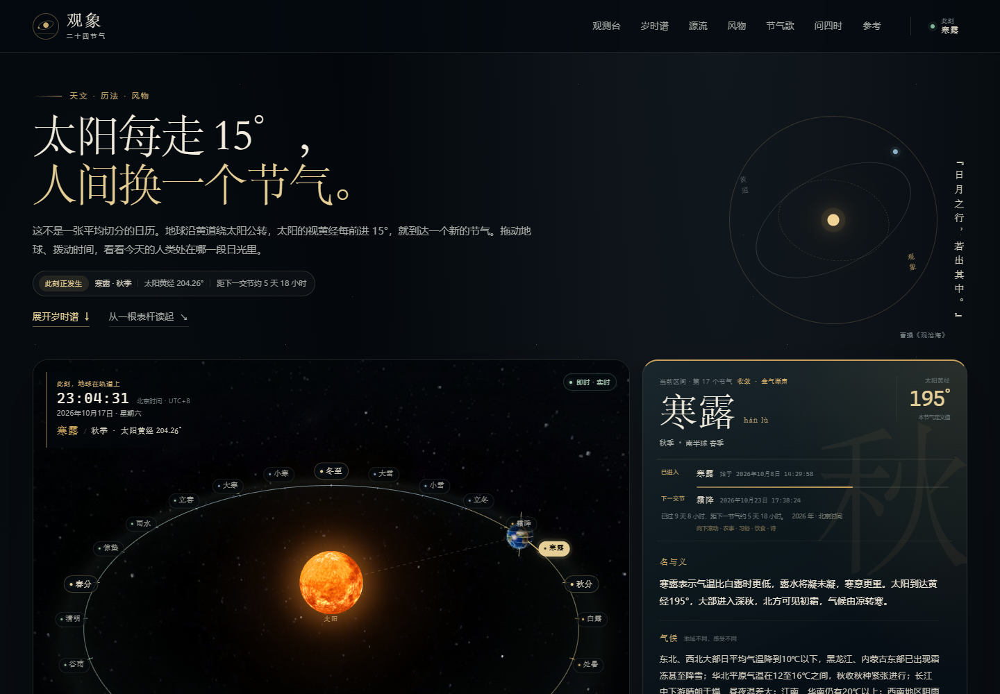
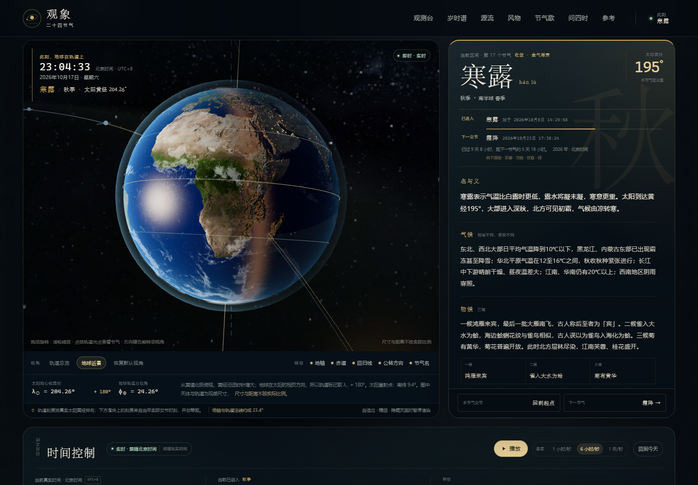
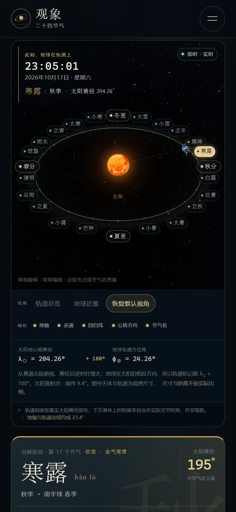

# 观象 · 二十四节气

一个以 **Three.js** 日地公转场景为核心的二十四节气中文互动科普网站。页面用真实的地心视黄经反解交节时刻，把节气、太阳黄经、地球位置与四季关系放在同一套模拟时间里，同时收录二十四节气的历史源流、文化价值、节气歌、科普问答与参考来源。



| 地球近景 | 移动端 |
| --- | --- |
|  |  |

## 快速开始

环境：Node.js 20+（本项目在 Node 24 上验证），推荐使用 pnpm。

```bash
pnpm install
pnpm dev        # http://127.0.0.1:5183
pnpm build      # 类型检查 + 生产构建，输出到 dist/
pnpm preview    # 预览生产构建，http://127.0.0.1:4180
```

检查与验收：

```bash
pnpm verify:astro     # 天文、坐标、节气歌、内容完整性的 955 项断言
pnpm dev              # 另开一个终端
pnpm verify:browser   # 桌面与移动端的 85 项浏览器断言（含纹理失败替代）
```

浏览器验收脚本使用本机 Microsoft Edge 的无头模式。若 Edge 不在默认路径：

```powershell
$env:EDGE_PATH = "C:\path\to\msedge.exe"
$env:PREVIEW_URL = "http://127.0.0.1:5183/"
pnpm verify:browser
```

脚本会把验收截图写入 `shots/`（不参与构建与提交）。

## 页面内容与交互

### 一处时间，驱动全部状态

默认打开页面时使用真实当前时间，并以下方 **Asia/Shanghai / UTC+8 标准时** 显示。播放、暂停、调速、拖动年度时间轴、日期选择、年份切换、点击轨道节气标记或节气歌字位，全部写入同一个 `simMs` 时间源。地球位置、太阳黄经、当前节气区间、轨道高亮、详情与交节时刻都由这一时刻派生。

- **实时 / 模拟时间**在页头、场景和控制器中都有明确标识。
- “当前已进入的节气区间”和“某个节气开始的准确交节时刻”分开显示。
- 播放速度：1 小时/秒、6 小时/秒、1 天/秒；播放时地球公转与自转同步推进。
- 年度时间轴上的刻度是当年真实交节时刻，间距并不相等。
- “回到今天”恢复实时时间与暂停状态。
- 支持的演示年份：**1900—2100**。年份选择、年份说明和日期范围严格限制在这一区间。

### 三维观测台

- 真实感地球纹理：昼面、夜面城市灯光、云层、法线贴图、海面高光与大气边缘。
- 地球公转与自转是两个独立变换；地球自转相位由太阳视赤经与格林尼治恒星时计算，尽可能让昼夜半球与真实地理对应。
- 地轴固定在惯性空间的方向上，与黄道面法线夹角约 23.44°，一年内不追随太阳。春分、夏至、秋分、冬至的受光关系因此自然正确。
- 辅助标识均可独立开关：地轴与轨道法线、赤道、南北回归线、公转方向、节气名称。
- 24 个节气标记按太阳黄经固定在轨道上增加 180° 的地球位置；轨道上的移动光点和左侧详情都来自同一模拟时刻。
- 视角：轨道总览、地球近景、恢复默认视角；支持鼠标拖动旋转、滚轮缩放、触屏单指旋转与双指缩放。
- 键盘：画布聚焦后方向键旋转，`+`/`-` 缩放，`Home` 或 `0` 恢复默认视角。

### 内容

- 24 个节气的名称、传统顺序、太阳黄经、季节、交节日期时间、释义、代表性气候、物候三候、农事、习俗、饮食、诗词、农谚。
- 13 个节点的历史时间线，覆盖日影观测、二至二分、八节、二十四名、进入历法、授时历、时宪历、国家级非遗与 UNESCO 名录等。
- 文化价值分为农事、日常、饮食、诗文、地方仪式、非遗传承六个侧面，并给出具体地名与做法。
- 常见四句节气歌完整互动：重复的「春」「夏」「秋」「冬」「雪」均按字位映射；点击字位会暂停并跳到该节气的交节时刻。
- 四季成因、节气间隔为何不均匀、公历日期为何较稳定、南北半球季节为何相反等六个科普问答。
- 页面提供说明与参考来源；纹理许可另见 `public/textures/CREDITS.md`。

## 天文与精确性

节气取太阳地心视黄经：春分 0°、夏至 90°、秋分 180°、冬至 270°，每 15° 一个节气。项目调用 [Astronomy Engine](https://github.com/cosinekitty/astronomy) 的 `SearchSunLongitude()`，在目标年份内反解太阳视黄经达到目标值的瞬间；**没有使用固定的日期表，也没有把一年平均裁成 24 段**。求根窗口的初始猜测只使用当年春分时刻与太阳平均角速度，最终时刻由视黄经求根器给出。

- 时间基准：北京时间（Asia/Shanghai，固定 UTC+8 标准时），与《中国天文年历》的发布口径一致。页面不叠加 1986—1991 年的历史夏令时。
- 校验：2024、2025 年共 48 个交节时刻与日本国立天文台《暦要項》公布值逐项比较，**全部落在公布分钟前后 1 分钟内，与分钟起点最大相差 43.2 秒**。官方公布值本身只到分钟，因此不把它当作秒级外部真值。
- 求根残差：所有校验年份在交节时刻的太阳视黄经反解残差 **< 1.16 × 10⁻⁸ 度**。
- 2024 年实际节气间隔：**14.721—15.729 天**，验证了“定气法”下并不等分的特征。
- 交叉年份：1 月 1 日仍会正确落在上一年的冬至区间，并在当年小寒交节时切换。
- 未来年份的 ΔT 为预测值。Astronomy Engine 使用 Espenak & Meeus 的 ΔT 多项式；越接近 2100 年，交节时刻的误差可能越大。因此 2026 年以后的时刻更适合作为科普与趋势参考，而非绝对精确的历书预报。

## 三维模型简化说明

- 黄道面为场景 XZ 平面，+Y 指向黄道北极；0° 黄经沿 +X，黄经增大方向为从 +Y 俯视逆时针（+X → −Z）。
- 太阳黄经 λ☉ 是地球看太阳的方向；地球位置角为 **φ⊕ = λ☉ + 180°**，并以此为节气标记和地球位置唯一的方位公式。
- 为便于观察，轨道使用半径 30 的圆形，地球半径 1.8、太阳半径 4.05。**天体大小和日地距离不按实际比例**；页面在场景与坐标说明中都明确标注。
- 地轴固定倾斜约 23.44°。1900—2100 年的黄赤交角变化小于 0.1°，为清晰表达四季关系，场景不逐年改变倾角。
- 未加入月球、其他行星、岁差、章动可视化与真实星表；星空为装饰性背景纹理与点星，不用于天文测量。
- 地球、太阳、银河纹理来自 Solar System Scope（CC BY 4.0）；地球法线与高光来自 three.js / NASA（MIT）。纹理缺失或被阻断时，页面会自动使用程序化纹理，并显示“部分纹理已使用替代材质”，详情与时间控制仍可用。
- 移动端自动使用较低像素比、较少球体分段与星点；页面不可见时停止渲染与模拟推进；组件卸载时释放几何体、材质、纹理、事件监听与 WebGL 上下文。

## 项目结构

```text
.
├─ src/
│  ├─ astro/
│  │  ├─ beijing-time.ts        # 北京时间、日期格式与解析
│  │  ├─ solar-terms.ts         # 视黄经反解交节时刻、当前区间、太阳状态
│  │  └─ scene-geometry.ts      # 黄经 → 3D 坐标、地轴与受光关系
│  ├─ data/
│  │  ├─ term-catalog.ts        # 24 节气基础数据
│  │  ├─ term-data.ts           # 24 节气详情内容
│  │  ├─ history-data.ts / history.ts
│  │  ├─ culture-data.ts / culture.ts
│  │  ├─ science-data.ts / science.ts
│  │  ├─ song.ts                # 四句节气歌与位置映射
│  │  └─ sources.ts             # 来源、方法与精度说明
│  ├─ three/
│  │  ├─ SolarSystemScene.ts    # 场景、轨道、标签、相机与交互
│  │  ├─ earth-shaders.ts       # 地球昼夜/云层/大气着色器
│  │  └─ texture-library.ts     # 纹理加载、程序化替代、释放
│  ├─ stores/observatory.ts     # 唯一模拟时间与派生状态
│  ├─ components/               # 场景、详情、时间控制与阅读章节
│  ├─ styles/                   # 基础、观测台、长卷、来源、响应式
│  ├─ AppRoot.vue
│  └─ entry.ts
├─ scripts/
│  ├─ verify-astro.mjs          # 天文与内容自检
│  ├─ verify-browser.mjs        # CDP 浏览器与移动端验收
│  └─ reference-nao.json        # 2024/2025 外部校验数据
├─ public/textures/             # 本地纹理与 CREDITS.md
├─ docs/                        # README 预览图
├─ index.html
└─ vite.config.ts
```

## 资料与署名

历史、非遗与文化部分参考 UNESCO、二十四节气国家级非遗项目资料、中国非物质文化遗产网与公开古籍原文；天文算法与年历校验参考 Jean Meeus《Astronomical Algorithms》、Astronomy Engine、NASA ΔT 资料与日本国立天文台《暦要項》。完整的来源说明与链接见网站“方法与来源”章节。

代码以 **MIT License** 发布。纹理许可为：

- 地球昼/夜面、云层、太阳表面、银河星图：Solar System Scope，CC BY 4.0。
- 地球法线、海陆高光：three.js examples（MIT），底图源自 NASA 公开影像。

如二次分发，请保留 `public/textures/CREDITS.md` 与页脚署名。

## 自检结果（2026-10-17）

- `pnpm verify:astro`：**955 项断言通过**。
- `pnpm verify:browser`：**85 项断言通过**（桌面、地球近景、时间轴拖动、交节边界、节气歌重复字映射、年份范围、移动端布局、菜单、无障碍名称、纹理失败替代）。
- `pnpm build`：类型检查通过，生产构建成功，并用 `vite preview` 的生产构建重复通过同一套浏览器验收。

> 以上数字来自本仓库当前版本的实际运行结果；浏览器验收需先启动站点（`pnpm dev` 或 `pnpm preview`）。
